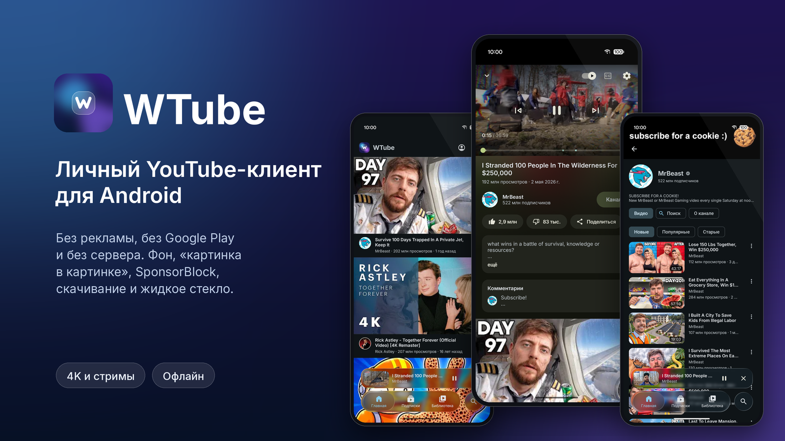

# WTube

**A personal YouTube client for Android: no ads, no Google Play, no server of its own.**

[Русский](README.md) · **English**

WTube is a home-made YouTube client in the spirit of NewPipe and SimpMusic: streams come through
[NewPipeExtractor](https://github.com/TeamNewPipe/NewPipeExtractor), the account is connected with cookies,
and the interface is dark, on "liquid glass".
The app is installed straight onto the phone; it needs neither a server nor Google Play. Google services are
needed only for caption auto-translation (ML Kit): without them it may not work.

> Unofficial client. Not affiliated with YouTube or Google. Use at your own risk and within the
> service's terms.

The screenshots show the Russian interface; the app also speaks English.

## Features

**Watching**
- Videos and live streams in high quality, background playback, mini player and picture-in-picture
- A player sheet with gestures: swipes, predictive back, full screen with auto-rotation
- Captions (including auto-translation), transcript, dubbed audio tracks, speed, sleep timer, autoplay, "stats for nerds" (codecs, frames, buffer, network)
- DeArrow (honest titles on the video page), hiding watched videos in subscriptions
- "Most replayed" moments (heatmap), SponsorBlock and Return YouTube Dislike
- Members-only videos: a badge on the thumbnail, a channel tab, hidden from recommendations and search by default (can be changed in Settings); playing them is still YouTube-only
- Live streams with seeking back within the broadcast and a "Go live" button; live chat (Top / Live chat, Super Chats,
  channel emoji) and chat replay on recorded streams, in sync with the video

**Account** (optional)
- Sign in with Google in a built-in WebView, or paste a `Cookie` header / `cookies.txt`
- The real Home, subscriptions, library, likes, playlists, comments, live chat messages
- Resume where you stopped on another device; "watched" bars on thumbnails
- The session is sealed with an Android Keystore key (AES-GCM) and never gets into logs

**Interface**
- Russian and English: follows the phone by default (a Russian phone gets Russian, any other language English), picked in Settings → Language; on Android 13+ also in the phone's settings for the app

**Without an account**
- Recommendations from the local watch history, search, channels, playlists
- "Not interested" and "Don't recommend channel", kept on the phone only
- Watch stats: how much time you spend watching by day, channel and video (Library → Stats)
- Backup of settings, history and stats

**Downloads**
- Video and audio downloads, H.264 + AAC joined on the phone, downloaded videos play from the file
- A downloaded video always plays from the file; downloaded audio only when the video is unavailable (no connection or YouTube did not answer), otherwise the video plays from the network
- Whole playlists (including Watch later, up to 500 videos): "up to 1080p / 720p / 480p / 360p" or audio only
- Downloads play as a playlist, in order or shuffled, offline

**Blocking bypass** (off by default)
- One switch in Settings → Blocking bypass: YouTube goes through [byedpi](https://github.com/hufrea/byedpi), a local SOCKS5 proxy
  that splits and shuffles packets so the provider's DPI does not recognize YouTube. No root and no VPN, other apps are not affected
- The way is found for each network (Wi-Fi, mobile operator) by itself: first a direct check, then presets in batches,
  with a real googlevideo stream and a speed measurement, not just a TLS handshake. What works is remembered for that network
- If YouTube stops loading again, the last working presets are checked; if that fails, a notification offers to search again
- Presets update from [`dpi/strategies.json`](dpi/strategies.json) in this repository without an app update;
  advanced users can set their own byedpi arguments or their own SOCKS5/HTTP proxy
- When off, nothing starts and nothing is downloaded, the app goes to the network directly
- The app's proxy in front of byedpi asks for a random password made at every bypass start; without it, it lets through only while the sign-in page is open (the built-in browser can't log in to SOCKS). The byedpi processes themselves don't support a password

## Data on the device

- Signed in with "Send views to YouTube" on, views go into the YouTube account's history; signed out or with the setting off, they don't.
- History, watch stats, searches and hidden items are kept only on the phone and shared by all accounts: the app is personal. Signing out can wipe them with a checkbox in the "Sign out" dialog.
- Android system backup and transfer to a new phone are off: nothing goes to the cloud or another device. Transfer is only by a file from Settings; that file is not encrypted (watch and search history, stats, settings; the account sign-in is not in it).
- With "Dislikes" on (on by default) the open video's id goes to the Return YouTube Dislike service. Can be turned off in Settings.
- SponsorBlock (on by default) gets the first 4 characters of the video id's hash, not the id itself, and your IP. Can be turned off in Settings.
- DeArrow (off by default) is the same service and works the same way: 4 characters of the id's hash and your IP, only for the open video.
- Update check (on by default): at start, at most once an hour, a request to `api.github.com`. Only this repository's page is opened. Can be turned off in Settings.
- With the blocking bypass on, YouTube server names are resolved over DNS-over-HTTPS at `1.1.1.1` and `8.8.8.8`, and strategy presets are downloaded from `raw.githubusercontent.com`.
- Caption auto-translation runs on Google's ML Kit. The library itself sends Google service metrics (device and app details, an installation id, error codes); its module starts with the app even if auto-translation is never used.
- The last loaded feeds (Home, subscriptions, playlists, YouTube history, up to 100 entries per list) are kept on the phone to open offline. On an unmetered network the pictures of the first 30 rows are also fetched in advance, from the same YouTube server as when scrolling. Each account has its own folder, deleted on sign-out. They are not in the transfer file; Settings → "Clear feed cache" removes them.

## Limitations and risks

- Signing in with cookies is unofficial: Google may find it suspicious and ask for confirmation or restrict the account. Sign in only with an account you are ready to risk.
- Streams are fetched without sign-in, so age-restricted and private videos don't open even when you are signed in.
- Downloads are kept in the app's private folder: they don't appear in the gallery and are deleted with the app. On Android 8–9 other apps with storage read permission can read that folder.

## Installation

Signed APKs of every version are in [Releases](https://github.com/WahhaWood/wtube/releases); GitHub Actions builds and signs them from `v*` tags.
Download the file and install it on the phone (Android 8.0+) or run `adb install -r WTube-<version>.apk`.
All versions are signed with one key, so they install over each other. Certificate SHA-256:
`7176fdd0e04f6dabef40d308596f3152e76d09f86ef2ae0d742a9600b1ee7948`.

Building, tests and the project layout are described in the [Russian README](README.md#сборка).

## License

[GPL-3.0](LICENSE). The project uses NewPipeExtractor (GPL-3.0) and ports interface ideas
from SimpMusic (GPL-3.0). The blocking bypass contains byedpi (MIT, sources in `app/src/main/cpp/byedpi`), the JNI glue and the initial
strategy list from ByeByeDPI (GPL-3.0). The Inter and Montserrat fonts are under the SIL Open Font License; license texts are in [`docs/licenses`](docs/licenses) and in the app (Settings → Licenses).
