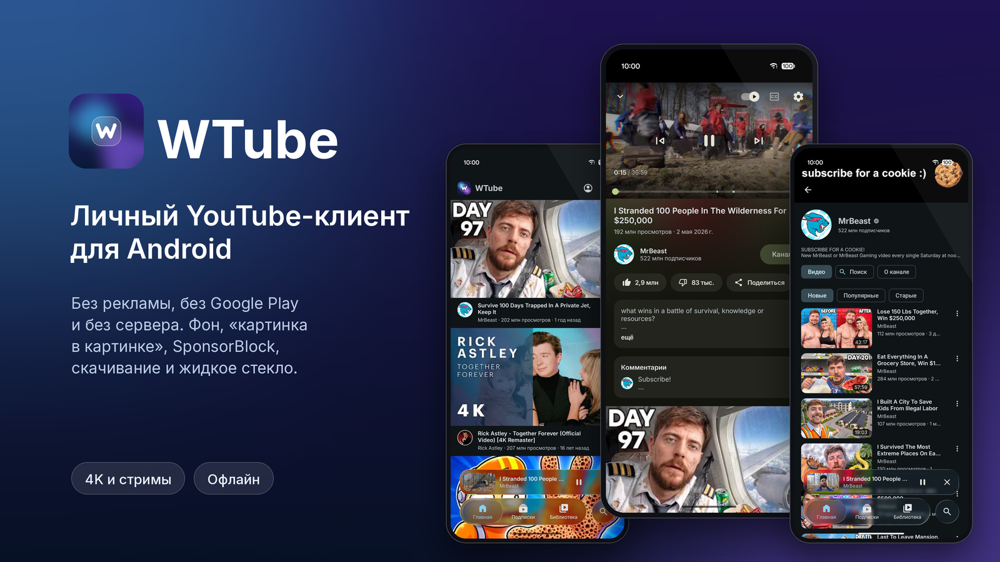
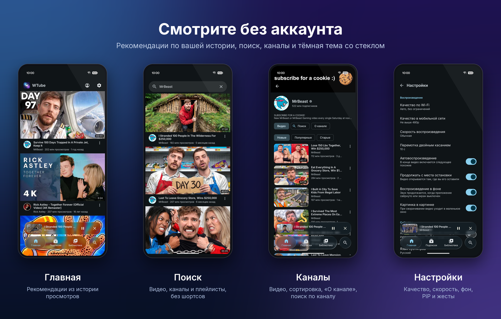
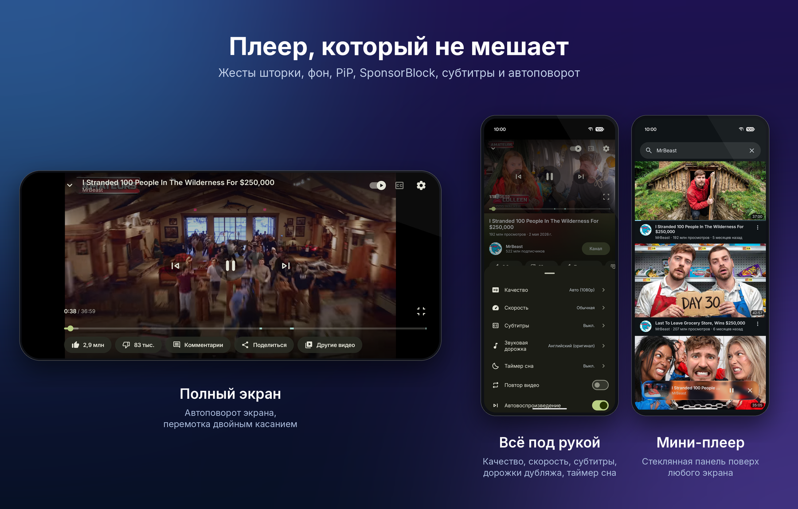

<div align="center">

# WTube

**Личный YouTube-клиент для Android: без рекламы, без Google Play и без своего сервера.**


[](https://github.com/WahhaWood/wtube/actions/workflows/ci.yml)

</div>

<p align="center"></p>

WTube — самодельный клиент YouTube в духе NewPipe и SimpMusic: потоки достаются
через [NewPipeExtractor](https://github.com/TeamNewPipe/NewPipeExtractor), аккаунт
подключается по cookies, интерфейс — тёмный, на «жидком стекле».
Приложение ставится на телефон напрямую через `adb`, ему не нужен ни сервер, ни Google-сервисы.

> Неофициальный клиент. Не связан с YouTube и Google. Используйте на свой риск и в рамках
> правил сервиса.

## Скриншоты

<p align="center"></p>
<p align="center"></p>

<sub>Превью и названия роликов на скриншотах принадлежат их авторам и показаны только для демонстрации интерфейса.</sub>

## Возможности

**Просмотр**
- Видео и трансляции в хорошем качестве, фоновое воспроизведение, мини-плеер и «картинка в картинке»
- Шторка плеера со жестами: свайпы, предиктивный «назад», полноэкранный режим с автоповоротом
- Субтитры (в том числе автоперевод), расшифровка, дорожки дубляжа, скорость, таймер сна, автовоспроизведение
- «Самые пересматриваемые» моменты (heatmap), SponsorBlock и Return YouTube Dislike
- Трансляции с перемоткой назад в пределах эфира и кнопкой «к эфиру»; чат трансляции («Топ» / «Весь чат», суперчаты,
  эмодзи канала) и повтор чата на записях эфиров, синхронно с видео

**Аккаунт** (по желанию)
- Вход через Google во встроенном WebView или вставкой `Cookie` / `cookies.txt`
- Настоящая главная, подписки, библиотека, лайки, плейлисты, комментарии, сообщения в чат трансляции
- Продолжение просмотра с места, где остановились на другом устройстве; полоски «просмотрено» на обложках
- Сессия хранится запечатанной ключом Android Keystore (AES-GCM) и никогда не попадает в логи

**Без аккаунта**
- Рекомендации по локальной истории просмотров, поиск, каналы, плейлисты
- «Не интересно» и «Не рекомендовать канал» — только на телефоне
- Статистика просмотров: сколько времени вы смотрите по дням, каналам и видео (Библиотека → Статистика)
- Бэкап настроек, истории и статистики

**Скачивание**
- Загрузка видео и аудио с склейкой H.264 + AAC, воспроизведение скачанного из файла
- Плейлист (в том числе «Смотреть позже») целиком: качество «до 1080p / 720p / 480p / 360p» или только звук
- Скачанное играет как плейлист — по порядку или вперемешку, без сети

**Обход блокировок** (выключен по умолчанию)
- Одна галочка в «Настройки → Обход блокировок»: YouTube идёт через [byedpi](https://github.com/hufrea/byedpi) — локальный SOCKS5-прокси,
  который режет и перемешивает пакеты так, что DPI провайдера не узнаёт YouTube. Без root и без VPN, другие приложения не затрагиваются
- Способ подбирается сам для каждой сети (Wi-Fi, мобильный оператор): сначала проверка напрямую, потом пресеты по очереди —
  с настоящим потоком googlevideo и замером скорости, а не только TLS-рукопожатием. Найденный запоминается для этой сети
- Если YouTube снова перестал грузиться, проверяются последние рабочие пресеты, не помогло — уведомление «подобрать заново»
- Пресеты обновляются из [`dpi/strategies.json`](dpi/strategies.json) этого репозитория без обновления приложения;
  для опытных — свои аргументы byedpi или свой прокси SOCKS5/HTTP
- Выключено — ничего не запускается и не загружается, приложение ходит в сеть напрямую

## Данные на устройстве

- История, статистика просмотров, поиск и скрытое лежат только на телефоне и общие для всех аккаунтов: приложение личное. При выходе из аккаунта их можно стереть галочкой в диалоге «Выйти».
- Системный бэкап Android выключен: в облако ничего не уходит. Перенос на другой телефон — бэкап в настройках.
- Медиа-сессию целиком видят само приложение и системные контроллеры (шторка, экран блокировки, Bluetooth). Другие приложения могут только ставить на паузу и продолжать, не видя, что играет.

## Ограничения и риски

- Вход через cookies — неофициальный способ: Google может счесть его подозрительным и запросить подтверждение или ограничить аккаунт. Входите только тем аккаунтом, которым готовы рискнуть.
- Потоки берутся без входа, поэтому видео 18+ и приватные не открываются, даже когда вы вошли.
- Загрузки лежат в закрытой папке приложения: в галерею они не попадают и удаляются вместе с приложением.

## Стек

| Область | Что используется |
| --- | --- |
| Язык и UI | Kotlin, Jetpack Compose, Material 3 (MaterialKolor), [Kyant backdrop](https://github.com/Kyant0/AndroidLiquidGlass) для стекла |
| Потоки | NewPipeExtractor, собственный мини-клиент InnerTube |
| Плеер | Media3 ExoPlayer + `MediaSessionService` |
| Сеть и данные | OkHttp, kotlinx.serialization, DataStore, Coil 3 |
| Сборка | Gradle (AGP 9), version catalog, Baseline Profile, R8 |

DI написан вручную, модуль один (`app`) плюс `baselineprofile`.

## Установка

Готовые подписанные APK всех версий лежат в [Releases](https://github.com/WahhaWood/wtube/releases). Релизы собирает и подписывает GitHub Actions по тегу `v*`.
Скачайте файл и поставьте на телефон (Android 8.0+) или выполните `adb install -r WTube-<версия>.apk`.
Все версии подписаны одним ключом, поэтому ставятся поверх друг друга. SHA-256 сертификата:
`7176fdd0e04f6dabef40d308596f3152e76d09f86ef2ae0d742a9600b1ee7948`.

## Сборка

Нужны JDK 21 и Android SDK (platform 37, NDK 29.0.14206865 и CMake 3.22.1 для byedpi). Путь к SDK задаётся в `local.properties`
(`sdk.dir=...`, файл не в git).

```bash
# debug-сборка и установка на подключённый телефон или эмулятор
./gradlew installDebug

# релизный APK (R8 + baseline profile)
./gradlew assembleRelease
```

Debug-сборка ставится как `dev.wahha.wtube.debug` и не мешает релизной.

### Подпись релиза

Ключ подписи в репозиторий не входит. Чтобы подписать релиз, создайте свой keystore и укажите
его в `~/.gradle/gradle.properties`:

```properties
wtube.keystore=/путь/к/wtube-release.jks
wtube.keystore.password=...
```

Алиас ключа — `wtube`. Без этих свойств release собирается неподписанным.

## Тесты

```bash
./gradlew testDebugUnitTest            # JVM: форматирование, выбор потоков, разбор InnerTube на фикстурах
./gradlew :app:connectedDebugAndroidTest   # на эмуляторе или телефоне, по сети
```

Если `ExtractorSmokeTest` упал, скорее всего YouTube что-то поменял — обновите версию
NewPipeExtractor в `gradle/libs.versions.toml`. В CI сетевые смоук-тесты пропускаются (`-Poffline`),
а раз в сутки идут отдельно (`nightly.yml`); при падении открывается issue.

## Устройство

```
app/src/main/kotlin/dev/wahha/wtube/
├── data/          настройки, история, сеть, расширения (SponsorBlock, RYD)
│   ├── account/   сессия, cookies, шифрование Keystore
│   └── innertube/ собственный клиент InnerTube и разбор лент
├── player/        PlaybackService, источники медиа, субтитры, автовоспроизведение
├── download/      сервис скачивания и склейка дорожек
├── dpi/           обход блокировок: byedpi в своих процессах, подбор стратегии, маршрут для OkHttp
└── ui/            экраны, тема, жидкое стекло, шторка плеера
```

## Лицензия

[GPL-3.0](LICENSE). Проект использует NewPipeExtractor (GPL-3.0) и портирует идеи интерфейса
из SimpMusic (GPL-3.0). В обходе блокировок — byedpi (MIT, исходники в `app/src/main/cpp/byedpi`), JNI-обвязка и стартовый
список стратегий из ByeByeDPI (GPL-3.0). Шрифты Inter и Montserrat распространяются по SIL Open Font License; тексты лицензий — в [`docs/licenses`](docs/licenses) и в приложении (Настройки → Лицензии).
